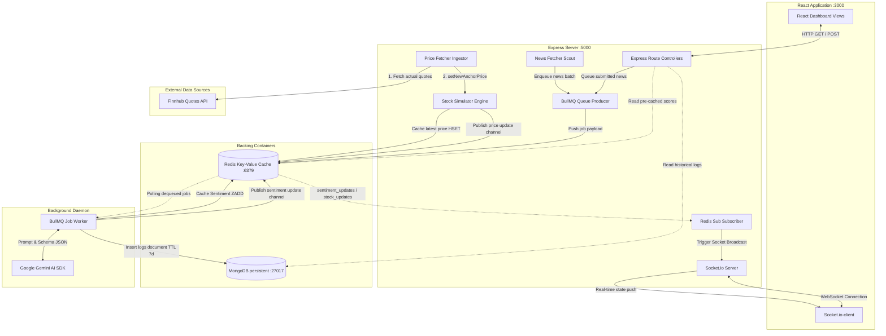

# StockPulse AI — Project Architecture Guide

This guide maps the complete software and systems architecture of StockPulse AI. It serves as an onboarding overview for new contributors to understand the relationships between frontend components, backend APIs, caching layers, queues, and background services.

---

## 🎨 Technology Stack Summary

* **Frontend**: React.js client utilizing TailwindCSS (custom theme configurations), Lucide React vector icons, standard HTML5/JS states, and Socket.io-client.
* **Backend**: Node.js & Express server hosting HTTP REST APIs and hosting the Socket.io WebSocket server.
* **Datastores**:
  - **MongoDB (Mongoose)**: Document store providing persistent history logs for analyzed news headlines and sentiment explanations.
  - **Redis (ioredis)**: In-memory store serving three distinct operations:
    1. **ZSET (Sorted Set)**: Pre-caches decayed sentiment rankings for the live leaderboard.
    2. **HASH**: Caches the latest real-time stock prices.
    3. **PUB/SUB**: Distributes updates from stock simulators and Gemini workers to the Express server.
* **Background Workers**:
  - **BullMQ**: Queue messaging library managed by Redis to ingest headline analysis jobs and run the Gemini AI parser asynchronously.
* **AI Engine**: Google Gemini AI API (`gemini-2.5-flash` model) configured in JSON-response mode.

---

## 📈 System-Wide Flow Diagram

The following Mermaid chart depicts port mappings, protocols, and data routes across components:



---

## ⚡ Network Port Mapping

| Port | Service | Communication Protocol | Description |
| :--- | :--- | :--- | :--- |
| `3000` | React Client | HTTP | Dev client host accessed by users. |
| `5000` | Express Backend | HTTP / WebSocket | Main API router, Socket.io WS server. |
| `6379` | Redis | TCP | Sorted Sets cache, Pub/Sub hub, BullMQ broker. |
| `27017` | MongoDB | TCP | Persistent store for Mongoose objects. |

---

## 📂 Structural Codebase Organization

```text
StockPulseAI/
├── backend/
│   ├── src/
│   │   ├── models/
│   │   │   └── Sentiment.js      # Mongoose Schema for AI news logs (TTL + Indexes)
│   │   ├── queues/
│   │   │   └── queueSetup.js     # BullMQ Producer queue instance
│   │   ├── services/
│   │   │   ├── decayService.js   # Time-decay score calculator
│   │   │   ├── stockService.js   # Live stock price wiggler (Mean Reversion)
│   │   │   ├── newsFetcher.js    # Scheduled News Ingestion Scout
│   │   │   └── priceIngestionService.js # Finnhub Stock Price Fetcher [NEW]
│   │   └── index.js              # Express API Server, Socket.io, & Scheduler
│   ├── worker.js                 # BullMQ Background Worker (Gemini integration)
│   ├── seedHeadlines.js          # DB seeder utility
│   ├── docker-compose.yml        # Docker compose backing containers config
│   └── .env                      # Connection URLs and API Keys
└── frontend/
    ├── src/
    │   ├── App.js                # Single-page MERN React dashboard code
    │   ├── index.css             # Tailwind base styles and micro-animations
    │   └── index.js              # React renderer entrypoint
    ├── tailwind.config.js        # Theme color palettes, fonts, and scrollbars
    └── package.json
```

---

## 🔑 Key Architectural Interlocks

### 1. The Real-time Pub/Sub Bridge
Instead of binding the WebSocket server directly inside the stock simulators or BullMQ workers, all real-time notifications are routed through **Redis Pub/Sub channels** (`stock_updates` and `sentiment_updates`). 
* **Benefit**: This keeps components completely decoupled. The Express server acts as a passive subscriber. It listens to Redis channels and pipes messages directly to active browser sockets.

### 2. Time-Decayed Sentiment Leaderboard
Stock sentiment is highly time-sensitive. We run a mathematical decay service that dampens older sentiment scores exponentially.
* **Benefit**: To ensure O(1) read latency on the leaderboard view, decay calculations are recalculated in the background every 5 minutes and pre-saved to a **Redis Sorted Set (ZSET)**. The API `/api/leaderboard` returns ranked outputs instantly.

### 3. Asynchronous Sentiment Queue
News analysis can take up to 2-3 seconds due to Google Gemini API requests. Running this synchronously inside Express HTTP request-response cycles would exhaust web sockets and cause API timeouts.
* **Benefit**: We offload Gemini API requests to a **BullMQ job worker (`worker.js`)** running in a separate process thread. The HTTP post endpoint responds with `202 Accepted` immediately, and Socket.io broadcasts updates when Gemini finishes.

### 4. Scout Ingestion & Cache Deduplication
To keep API quotas safe, **The Scout (`newsFetcher.js`)** runs on a scheduled interval (1 hour). It pulls headlines, normalizes keywords to target symbols, hashes payloads via SHA-256, and locks signatures inside a **48-Hour Redis Cache** (`SETNX`).
* **Benefit**: Avoids analyzing the same articles multiple times. Unique articles are bundled in a batch payload so the Analyst makes only one Gemini call instead of 20, saving 95% of API credits.

### 5. Hybrid Price Ingestion & Anchoring
To display real stock quotes without hitting free-tier API rate limits (60 calls/minute), **The Ingestor (`priceIngestionService.js`)** polls Finnhub quotes every **2 minutes**.
* **Benefit**: Ticks fluctuate locally every 2 seconds via an **Ornstein-Uhlenbeck Mean Reversion** formula to keep dashboard animations active. Newly fetched real prices are merged smoothly over **3 sub-ticks spaced 500ms apart** to prevent "teleportation" visual glitches.
